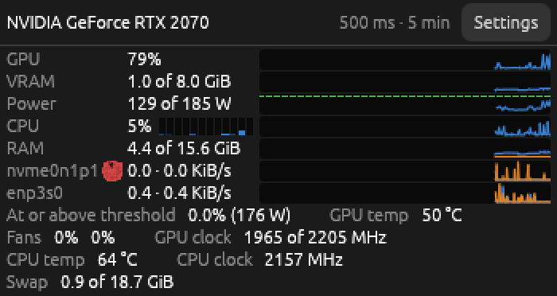

# slm

A small window that shows how loaded your Linux machine is: the GPU, CPU, memory, disks and network, each with its current value and a chart of the last few minutes. Keep it beside a game or a long GPU job to see at a glance what is holding the work back.



## What it shows

- **NVIDIA GPU:** load, VRAM, power against the card's limit, temperature, fans and clock.
- **CPU:** load, each logical CPU, temperature and clock.
- **RAM and swap.**
- **Disks:** reading and writing, and a pie of how full each one is, yellow from 70% and red from 90%.
- **Network:** receiving and sending, per adapter.

Point at a chart or a pie for its numbers. The **Settings** button sets how often slm measures, how far back the charts go, and which lines and charts are shown.

## Install

You need Rust 1.95 or newer and, for an NVIDIA GPU, NVIDIA's own driver (`nouveau` gives slm nothing to read). Then:

```sh
cargo install --locked --git https://github.com/mirandadam/slm
slm
```

On Ubuntu, the build may first need `sudo apt install libxcb-render0-dev libxcb-shape0-dev libxcb-xfixes0-dev libxkbcommon-dev libssl-dev`.

slm has been used on Ubuntu with GNOME on X11. It is meant to work on Wayland too, but nobody has tried it there yet.

## More

- [docs/reference.md](docs/reference.md): where each number comes from, how the GPU's power is computed, and how to work on slm.
- [SPEC.md](SPEC.md): the decisions behind it.

## License

MIT or Apache-2.0, at your option.
